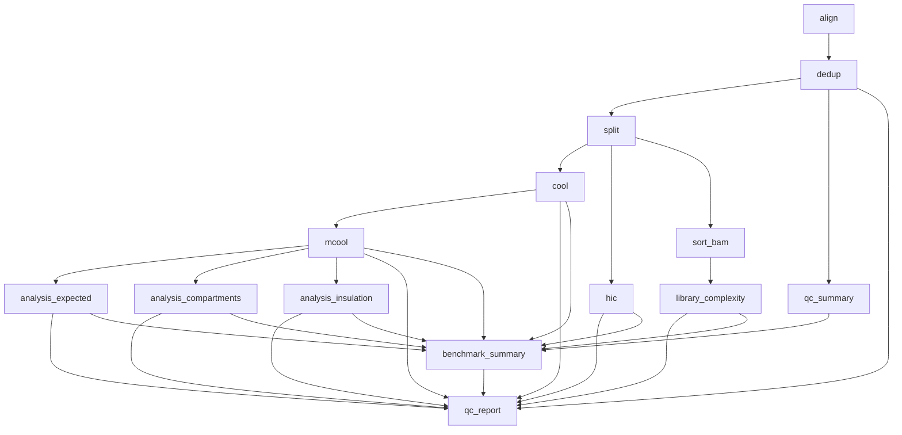
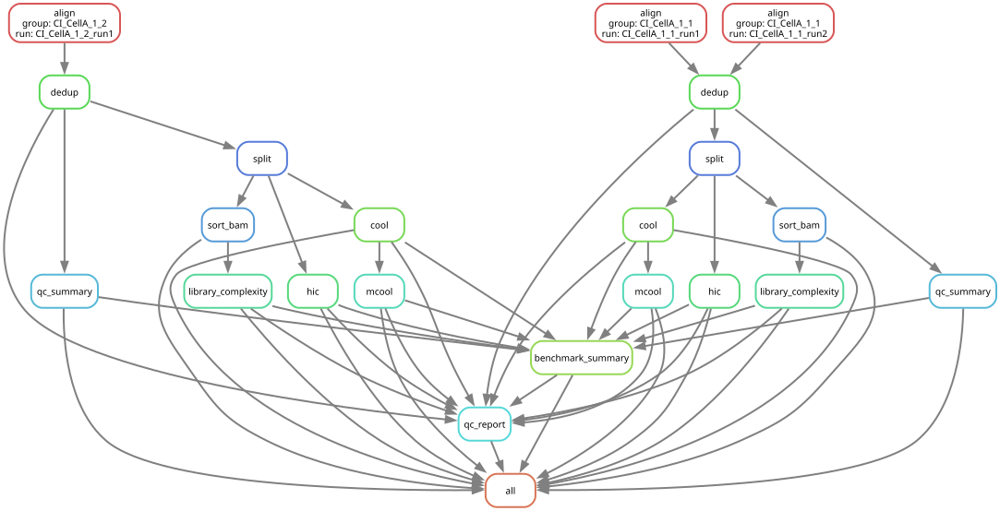
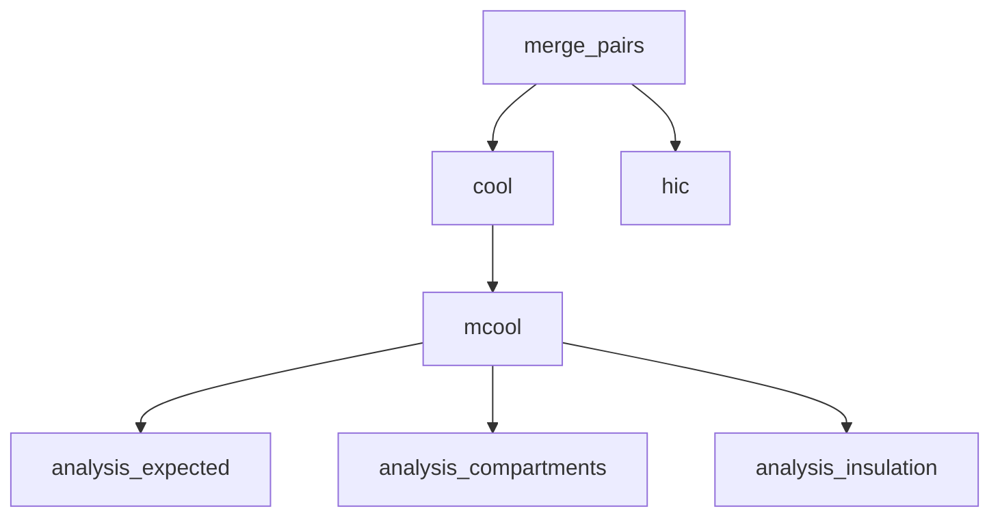

# MicroCPipe code guide

What each part of the codebase does, what it reads and writes, and how the
steps connect. For running the pipeline, see [`README.md`](README.md); for errors, see
[`docs/troubleshooting.qmd`](docs/troubleshooting.qmd).

---

## Overview

### What this pipeline does

MicroCPipe processes **Micro-C** sequencing data. Micro-C is a chromosome
conformation capture assay in which chromatin is digested to single
nucleosomes with MNase, so that contacts between DNA ends can be mapped at
nucleosome scale. The pipeline takes paired-end FASTQ files and produces
contact maps (`.cool`, `.mcool`, `.hic`) and a QC dashboard.

The design follows PhanstielLab's dietJuicer: a **Core** workflow
(FASTQ to maps), a **Merge** workflow (combine libraries), one samplesheet,
one config file, and SLURM profiles. The alignment recipe (`bwa mem -5SP
-T0`, `pairtools parse / sort / merge / dedup / split`) follows Dovetail's
Micro-C guidance.

### Data flow

```text
MicroCSamplesheet.txt  (one row per sequencing run)
    ↓  align      bwa mem -5SP -T0 | pairtools parse | pairtools sort
aligned/{run}.pairsam.gz                         (temporary)
    ↓  dedup      pairtools merge | pairtools dedup --mark-dups
{group}_dedup.pairsam.gz (temporary) + {group}_dedup_stats.txt
    ↓  split      pairtools split | samtools view; pairtools select UU/UR/RU
{group}.pairs.gz  (via temporary {group}_all.pairs.gz)  +  {group}_unsorted.bam (temporary)
    ↓  cool       cooler cload pairs          ↓ sort_bam  samtools sort/index
{group}.cool                                  {group}_mapped.PT.bam
    ↓  mcool      cooler zoomify              ↓ library_complexity  preseq
{group}.mcool                                 {group}_libraryComplexity.txt
{group}.pairs.gz → hic   juicer_tools pre → {group}.hic
{group}_dedup_stats.txt → qc_summary → {group}_qc_summary.txt
everything → benchmark_summary → benchmarking.tsv
everything → qc_report → qc/MicroC_qc_report.html
```

### What has been tested

The Core workflow completed all 12 steps on a 25M-pair mouse (mm10) library on
one SLURM cluster and ran locally on macOS; the Merge workflow completed on two
replicates. The optional `analysis` rules are off by default and only dry-run
tested so far. Profiles for other sites are templates that may need small edits.

### Setup and launch

1. **`MicroCSamplesheet.txt`**: one tab-separated row per sequencing run.
   `Name`, `Read1`, `Read2`, `Sequencing_Directory`, `Seq_Rep` and every
   `mergeBy` column are required; other columns are metadata.
2. **`config/MicroCConfig.yaml`**: reference, `mergeBy`, output formats,
   resolutions, alignment parameters, QC thresholds, optional analysis.
3. **`profiles/<site>/`**: the compute site, chosen by `--profile`, then
   `$MICROC_PROFILE`, then `hpcProfile` in the config.
4. **Per-cluster environment variables** (in `~/.bashrc`, outside git):
   `MICROC_PROFILE` picks the profile; `MICROC_OUTPUT_ROOT` is the folder a
   relative `outputDir` goes under.

```bash
sbatch MicroCPipe.sh          # Core workflow
bash MicroCPipe.sh -n         # dry run
sbatch MicroCMerge.sh         # Merge workflow
bash unlock.sh                # release the Snakemake lock
```

---

## Launchers

### `MicroCPipe.sh` and `MicroCMerge.sh`

Identical except for the Snakefile they run. Each:

1. Parses `--configfile` (default `config/MicroCConfig.yaml`) and
   `--profile`; every other argument is passed to `snakemake`.
2. Resolves the profile: `--profile`, then `$MICROC_PROFILE`, then
   `hpcProfile` read from the config with `sed`.
3. Resolves `outputDir` the same way `common.smk` does (relative paths go
   under `$MICROC_OUTPUT_ROOT`, else `$PWD`), to know where to put SLURM
   logs.
4. Sources `profiles/<site>/env.sh`, creates a venv in `env/` if missing,
   and `pip install`s `config/requirements.txt`. The venv is **not
   activated**: the launcher calls `env/bin/python3 -m snakemake` directly. If
   its `bin/` were on `PATH`, tools in conda environments whose path is longer
   than Linux's 127-character interpreter-line limit (common on scratch
   filesystems) would run under the venv's Python and fail with `No module
   named ...`.
5. If the profile's `config.yaml` has `executor: slurm`, adds
   `--slurm-logdir <outputDir>/logs_slurm` and rate limits.
6. Runs `snakemake -s workflows/<...>.snakefile --profile <profile>
   --configfile <config> --rerun-incomplete --keep-going -p`.

The `#SBATCH` header makes the launcher itself a small 16 GB, 10-day job;
each rule becomes its own SLURM job through the Snakemake SLURM executor.
SLURM profiles set `cores: 100`: without it Snakemake caps a rule's `threads`
at the launcher job's CPUs, so `align` would run with 3 threads instead of 16.
On `profiles/local`, run it with `bash` instead of `sbatch`.

### `unlock.sh`

Sources the site `env.sh` and runs `env/bin/python3 -m snakemake --unlock`
(the venv is not activated) on the Core Snakefile (or the Merge one with
`--merge`). Run it after a crash, then resubmit the launcher.

---

## The workflow files

### `config/MicroCConfig.yaml`

The single source of truth read by both workflows (as `config`). See
`docs/configuration.qmd` for every key. Key groups:

| Group | Keys |
|-------|------|
| Samples | `samplesheet`, `mergeBy`, `merge:` (`samplesheet`, `mergeBy`) |
| Site and location | `hpcProfile`, `outputDir` |
| Reference | `genome`, `fasta`, `chromSizes` |
| Formats | `outputs`, `base_resolution`, `resolutions`, `balance`, `hic_resolutions`, `juicerTools`, `javaMem` |
| Alignment | `min_mapq`, `max_inter_align_gap`, `walks_policy`, `bwa_flags` |
| Notifications | `notify` (`email`, `events`, `command`) |
| QC | `make_bam`, `library_complexity`, `preseq_extrap`, `qc_report`, `qc_thresholds` |
| Downstream | `analysis`, `analysis_resolution`, `insulation_windows` |

### `workflows/rules/common.smk`

Included by both Snakefiles first. It:

- reads `outputs` and checks it is a subset of `cool`, `mcool`, `hic`;
- reads `base_resolution` and `resolutions`, adds the base resolution to
  the list, sorts it, and raises an error if any resolution is not a
  multiple of the base;
- reads `hic_resolutions` (defaults to the cooler resolutions);
- defines `outdir()` and `OUT`: `outputDir`, with a relative path placed
  under `$MICROC_OUTPUT_ROOT` when that is set, else the current directory;
- defines `ENVS`, the `envs/` folder;
- defines `NOTIFY` and `EMAIL` (`$MICROC_EMAIL`, else `notify: email:`),
  `notify(event, body, run_name)` and `log_tail(path, n=40)`. `notify`
  sends one message by running `notify: command:` (default
  `mail -s {subject} {email}`, body on stdin) when an address is set and
  the event is in `notify: events:`; any failure to send is printed to
  stderr and ignored. Both Snakefiles call it from `onstart`, `onsuccess`
  and `onerror` (the last attaches `log_tail` of the Snakemake log), which
  Snakemake does not run on dry runs;
- defines `format_targets(groups)`: for each group the final files for each
  entry of `outputs`, plus `analysis/{group}_{name}.done` for each entry of
  `analysis`.

Rules carry **no** memory, runtime or partition of their own, only
`threads`; the profile's `set-threads` / `set-resources` supply the rest.

### `workflows/MicroCPipe.snakefile`: the Core DAG

Text version of the graph: `align` feeds `dedup`; `dedup` feeds `split` and `qc_summary`; `split` feeds `cool`, `hic` and `sort_bam`; `cool` feeds `mcool`; `sort_bam` feeds `library_complexity`; the optional `analysis_*` rules read `mcool`; everything feeds `benchmark_summary` and `qc_report`.



The graph above is the rule graph (one box per rule). For a concrete example, this is the
job-level graph for the test fixture, three sequencing runs that become two groups: runs of
the same group fan in at `dedup`, and everything after that is per group.



*Generated from the Snakefiles' rule and job graphs; if you change a rule, update the diagrams by hand.*

**Samplesheet handling.** Reads `samplesheet` with pandas (all columns as
strings), checks that `Name`, `Read1`, `Read2`, `Sequencing_Directory`,
`Seq_Rep` and the `mergeBy` columns exist, builds `R1` / `R2` by joining
`Sequencing_Directory` and the filename, and defines:

- `group`: the `mergeBy` values joined with `_` (the output prefix);
- `run`: `{group}_run1`, `{group}_run2`, ... one per row of a group (the
  alignment job ID);
- `GROUPS`, `RUNS` (indexed by run), `RUNS_BY_GROUP`.

`wildcard_constraints` restrict `{group}` and `{run}` to the real names.

**Targets.** `rule all` asks for `format_targets(GROUPS)`, `qc_targets()`
and `benchmarking.tsv`. `qc_targets()` is, per group, `{group}_qc_summary.txt`,
`{group}_mapped.PT.bam` (when `make_bam` is true), and (when both
`library_complexity` and `make_bam` are true) `{group}_libraryComplexity.txt`, plus the dashboard when `qc_report` is true.

**Rules.**

| Rule | Per | Command | Output |
|------|-----|---------|--------|
| `align` | run | `bwa mem {bwa_flags} \| pairtools parse --min-mapq --walks-policy --max-inter-align-gap --chroms-path \| pairtools sort` | `{group}/aligned/{run}.pairsam.gz` (temp) |
| `dedup` | group | `pairtools merge \| pairtools dedup --mark-dups --output-stats` | `{group}_dedup.pairsam.gz` (temp), `{group}_dedup_stats.txt` |
| `split` | group | `pairtools split --output-pairs {group}_all.pairs.gz --output-sam - \| samtools view -b`, then `pairtools select '(pair_type=="UU") or ... "UR" ... "RU"'`, then remove the `_all` file | `{group}.pairs.gz` (unique pairs only), `{group}_unsorted.bam` (temp) |
| `sort_bam` | group | `samtools sort`, `samtools index` | `{group}_mapped.PT.bam`, `.bai` |
| `qc_summary` | group | `scripts/get_qc.py -p {stats}` | `{group}_qc_summary.txt` |
| `library_complexity` | group | `preseq lc_extrap -bam -pe -extrap {preseq_extrap} -step 1e7 -seg_len 1000000000`; if preseq fails (very shallow library) it warns and writes a header-only table | `{group}_libraryComplexity.txt` |
| `benchmark_summary` | once | `scripts/benchmarking.py {outputDir}` | `benchmarking.tsv` |
| `qc_report` | once | `scripts/qc_report.py --outdir --config --out` | `qc/MicroC_qc_report.html` |

Notes:

- Multi-step rules (`align`, `dedup`, `split`, `sort_bam`, `library_complexity`)
  truncate their log once (`: > {log}`) and then append (`2>>`), so the log holds
  every step. The `qc_*` scripts call `$CONDA_PREFIX/bin/python` explicitly,
  because a launcher venv earlier on `PATH` would be the wrong interpreter.
- `align` and the other pairtools rules use `envs/microc_align.yml`;
  `align` uses 16 threads for `bwa`, `pairtools parse` and `sort`, and
  works in a temporary directory `{group}/tmp_{run}` that it deletes.
- `dedup` merges all of a group's runs before marking duplicates, so
  duplicates are found across sequencing runs of the same library.
- `dedup` marks duplicates (`DD`); `split` then keeps only unique-unique,
  unique-rescued and rescued-unique pairs, so duplicates, unmapped,
  multi-mapped and walk pairs never reach `cool`, `mcool` or `hic`.
- `sort_bam` is requested whenever `make_bam` is true (the sorted BAM is a
  final output); with `make_bam: false` no BAM is kept and preseq is skipped.
- `benchmark_summary` waits for the formats and QC summaries so that every
  benchmark file exists when it runs.
- `qc_report` waits for every group's dedup stats, preseq output (if
  enabled), format targets and `benchmarking.tsv`, then runs once for all
  groups. It reads thresholds from the config file the run was started with
  (`--configfile`, else `config/MicroCConfig.yaml`).

**Hook.** `get_pairs(wildcards)` returns `{OUT}/{group}/{group}.pairs.gz`;
`rules/formats.smk` is included last and uses it.

### `workflows/MicroCMerge.snakefile`: the Merge DAG

Text version: `merge_pairs` feeds `cool` and `hic`; `cool` feeds `mcool`; the optional `analysis_*` rules read `mcool`.



Reads `merge.samplesheet` and `merge.mergeBy` (falling back to the top-level
`mergeBy`). The samplesheet must have a `pairs` column (path to a Core
`.pairs.gz`) and the `mergeBy` columns. Rows are grouped by the joined
`mergeBy` values; duplicate `pairs` paths within a group are dropped.

| Rule | Per | Command | Output |
|------|-----|---------|--------|
| `merge_pairs` | group | `pairtools merge -o` | `{group}/{group}_merged.pairs.gz` |

Merge group names are prefixed `merged_` (`merged_` + the `mergeBy` values
joined with `_`), so the outputs are
`output/merged_<g>/merged_<g>.{cool,mcool,hic}` and never collide with Core
groups.

`get_pairs` returns the merged file, so `cool`, `mcool`, `hic` and
`analysis_*` from `formats.smk` build the maps from it. The Merge workflow
has no QC rules: the input pairs were already deduplicated per library by
the Core workflow, and merging does not deduplicate across libraries.

### `workflows/rules/formats.smk`: contact maps

Included by both workflows after they define `get_pairs`.

| Rule | Env | Command | Output |
|------|-----|---------|--------|
| `cool` | `microc_cooler` | `cooler cload pairs -c1 2 -p1 3 -c2 4 -p2 5 --assembly {genome} {chromSizes}:{base_resolution}` (1 thread) | `{group}/{group}.cool` (not balanced) |
| `mcool` | `microc_cooler` | `cooler zoomify [--balance] -r {resolutions}` | `{group}/{group}.mcool` (every level balanced if `balance: true`) |
| `hic` | `microc_hic` | `java -Xmx{heap} -jar {juicerTools} pre --threads -r {hic_resolutions}` | `{group}/{group}.hic` |

`hic` works in `{group}/tmp_hic` (set as `java.io.tmpdir`) and removes it
afterwards. Memory is the one setting users most often change: the JVM heap is
`javaMem` if set in the config, otherwise 85% of the rule's `mem_mb` from
the profile (`int(mem_mb * 0.85)` MB), so raising `hic: mem_mb` is normally
enough.

**Optional analysis** (`analysis:` in the config; each entry runs on the
`.mcool` and writes a `.done` marker beside its output):

| Rule | Command | Resolution key |
|------|---------|----------------|
| `analysis_expected` | `cooltools expected-cis` | `analysis_resolution.expected` |
| `analysis_compartments` | `cooltools eigs-cis` | `analysis_resolution.compartments` |
| `analysis_insulation` | `cooltools insulation {insulation_windows}` | `analysis_resolution.insulation` |
| `analysis_loops` | `mustache -f ... -r ...` | `analysis_resolution.loops` |

All write into `{group}/analysis/`. The chosen resolution must be one of
`resolutions`.

---

## Scripts

### `scripts/get_qc.py`

From Dovetail's Micro-C repository. Reads a `pairtools dedup` stats file
(`-p`, whitespace-separated key / value lines) and prints a plain-text
table to stdout (captured as `{group}_qc_summary.txt`) using `tabulate`.
It reads the keys `total`, `total_unmapped`, `total_mapped`, `total_dups`,
`total_nodups`, `cis`, `trans`, `cis_1kb+` and `cis_10kb+`.

| Row | Denominator |
|-----|-------------|
| Total / Unmapped / Mapped / PCR Dup / No-Dup read pairs | total read pairs |
| No-Dup cis, trans, cis < 1 kb, cis >= 1 kb, cis >= 10 kb, valid (cis >= 1 kb + trans) | no-dup read pairs |

### `scripts/qc_report.py`

Builds the static dashboard `qc/MicroC_qc_report.html` for all groups under
`--outdir`, using the thresholds in `qc_thresholds` read from `--config`.
It reads the per-group dedup stats, preseq output and benchmarks (see
`docs/qc.qmd` for each panel). Run by the `qc_report` rule with
`envs/microc_qc.yml` (pandas, numpy, pyyaml, tabulate, plotly, cooler).

### `scripts/benchmarking.py`

Usage: `benchmarking.py OUTDIR > benchmarking.tsv`. Reads every
`OUTDIR/*/benchmarks/*.tsv`, labels each by group and rule (the filename
minus the `{group}_` prefix), keeps the maximum per group and rule, and
writes a table with run time (`h:mm:ss`), peak memory (`max_rss`, ...) and
I/O columns.

### `scripts/juicer_tools_1.22.01.jar`

The juicer_tools jar used by the `hic` rule (`pre`). Needs Java, provided by
`envs/microc_hic.yml` (OpenJDK 11).

---

## Environments (`envs/`)

| File | Rules | Contents |
|------|-------|----------|
| `microc_align.yml` | `align`, `dedup`, `split`, `sort_bam`, `library_complexity`, `merge_pairs` | bwa, pairtools, samtools, preseq, pairix |
| `microc_cooler.yml` | `cool`, `mcool`, `analysis_expected`, `analysis_compartments`, `analysis_insulation` | cooler, cooltools |
| `microc_mustache.yml` | `analysis_loops` | cooler, mustache-hic (pip; compiles C++, so kept apart so it cannot break the core environments) |
| `microc_hic.yml` | `hic` | OpenJDK 11 |
| `microc_qc.yml` | `qc_summary`, `benchmark_summary`, `qc_report` | (conda-forge + bioconda) pandas, numpy, pyyaml, tabulate, plotly, cooler |

Snakemake builds each on first use (`software-deployment-method: conda` in
every profile). The channels are conda-forge and bioconda.

---

## Profiles (`profiles/<site>/`)

Each site has two files.

- **`env.sh`**: sourced by the launchers and `unlock.sh`. Makes `python3`
  (>= 3.11) and `conda` (>= 24.7.1) available. `MICROC_CONDA_ROOT` points to
  a Miniforge install other than `$HOME/miniforge3`.
- **`config.yaml`**: a Snakemake profile. SLURM sites set `executor: slurm`,
  `jobs`, `latency-wait`, `default-resources` (account, partition, runtime,
  memory), `set-threads` and `set-resources` for every rule. `local` sets
  `cores: all` and a global memory limit instead.

| Folder | Site |
|--------|------|
| `biowulf`, `longleaf`, `pioneer` | Examples for particular sites; account, partition and limits must be edited for your use |
| `slurm-template` | Copy and fill in the `<...>` values |
| `local` | One machine, no scheduler |

---

## Tests and CI

- `tests/test_dryrun.py` with the tiny fixture in `tests/dryrun/` (empty
  placeholder FASTQ / pairs / FASTA files, a small config and
  samplesheets): Snakemake dry runs of both workflows. A dry run checks the
  samplesheet parsing, the config validation and that the DAG builds; it
  runs no tools. `tests/test_qc_report.py` tests the dashboard script.
- `.github/workflows/ci.yml`: installs `config/requirements.txt` plus the
  test dependencies, checks the launchers parse (`bash -n`) and runs
  `pytest tests` on every push to `main` and every pull request.
- `.github/workflows/quarto-publish.yml`: renders `docs/` and publishes to
  GitHub Pages on pushes to `main` that touch `docs/`.

---

## Reading order

1. `config/MicroCConfig.yaml` and `MicroCSamplesheet.txt` (the inputs)
2. `workflows/rules/common.smk` (shared helpers)
3. `workflows/MicroCPipe.snakefile` (Core DAG)
4. `workflows/rules/formats.smk` (maps)
5. `workflows/MicroCMerge.snakefile`
6. `scripts/get_qc.py`, `scripts/qc_report.py`
7. `profiles/<your site>/config.yaml`

## Project layout

```text
MicroCPipe/
├── MicroCPipe.sh  MicroCMerge.sh  unlock.sh
├── MicroCSamplesheet.txt  MicroCMergeSamplesheet.txt
├── config/        MicroCConfig.yaml  requirements.txt
├── envs/          microc_{align,cooler,hic,mustache,qc}.yml
├── profiles/      biowulf  local  longleaf  pioneer  slurm-template
├── scripts/       get_qc.py  qc_report.py  benchmarking.py  juicer_tools_1.22.01.jar
├── workflows/     MicroCPipe.snakefile  MicroCMerge.snakefile  rules/{common,formats}.smk
├── tests/         pytest + dry-run fixture (tests/dryrun/)
└── docs/          Quarto book
```

## Conventions

- Every output is under `{outputDir}/{group}/`, named `{group}.<ext>` or
  `{group}_<what>.<ext>`.
- Every rule writes a log to `{group}/logs/` and a benchmark to
  `{group}/benchmarks/` (the dashboard's `qc_report` rule logs to
  `qc/qc_report.log`).
- Rules never set memory or runtime; the profile does.
- Temporary working directories (`tmp_*`) are created inside the group's
  output folder and removed at the end of the rule.
- Nothing is hard-coded to a cluster: paths and sites come from the config,
  the profile and the two environment variables.

## Common pitfalls

- **Columns in `mergeBy` decide what is one library.** Leaving `Seq_Rep`
  out (the default) merges sequencing replicates; adding it keeps them as
  separate groups.
- **Relative paths** in `Sequencing_Directory` and in the merge sheet's
  `pairs` column are resolved from the folder you launch from, not from
  `outputDir`.
- **`chromSizes` decides the bins.** Every contig listed becomes part of
  the maps; trim the file to the chromosomes you want.
- **`hic` memory.** The JVM heap is 85% of the profile's `hic` `mem_mb`
  unless `javaMem` is set; if you set it, keep it below `mem_mb`.
- **`resolutions` and `base_resolution`.** Each resolution must be a
  multiple of the base; the base is added automatically.
- **Analysis resolutions** must appear in `resolutions`, and
  `compartments` / `insulation` expect a balanced `.mcool`
  (`balance: true`).
