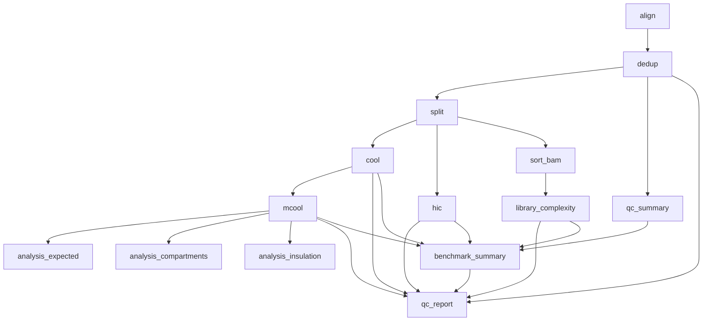
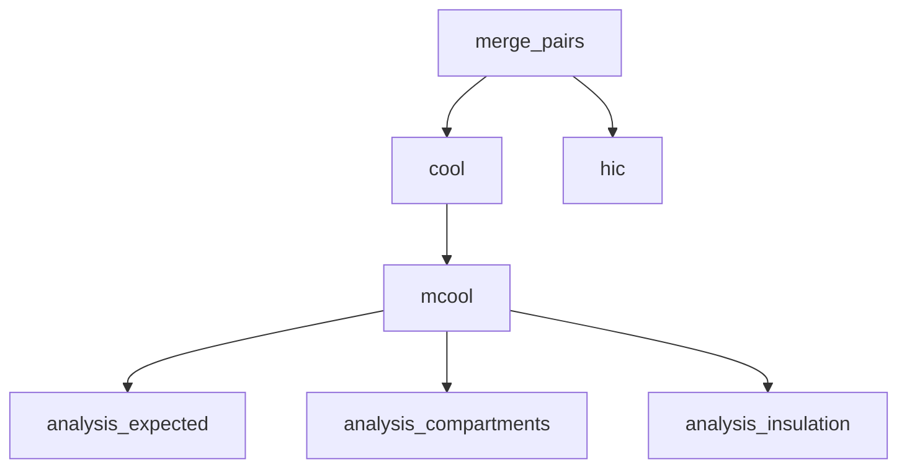

# MicroCPipe: Micro-C Processing Pipeline

**In 30 seconds.** MicroCPipe takes paired-end **Micro-C** sequencing files
(FASTQ) and produces contact maps (`.cool`, `.mcool`, `.hic`) plus one
shareable HTML **QC dashboard** with pass / warn / fail traffic lights, so you
can judge a library in minutes. You describe your data in two small text files
(a samplesheet and a config), run one command, and wait. You do not need to
know Snakemake or SLURM: the launcher scripts handle both, and software is
installed automatically on first use. It runs on a laptop or on any SLURM
cluster.

| I want to... | Go to |
|--------------|-------|
| Run it on my data | [Quick start](#quick-start) |
| Know what to edit | [What do I edit?](#what-do-i-edit) |
| Understand a word | [Glossary](#glossary) |
| See what files I get | [Outputs](#outputs) |
| Fix an error | [Troubleshooting](docs/troubleshooting.qmd) (also summarised [below](#troubleshooting)) |
| Pick memory / time for a bigger library | [Choosing resources](docs/cluster.qmd#choosing-resources) |
| Understand the QC dashboard | [Reading the QC dashboard](docs/qc.qmd) |
| Read every config key | [Configuration](docs/configuration.qmd) |
| Follow a worked example | [Vignette](docs/vignette.qmd) |

> **What has been tested**
>
> - **Core workflow (FASTQ to maps and QC): tested for real.** A 25-million-read-pair
>   mouse embryonic stem cell Micro-C library (whole mm10 genome) completed all 12
>   Core steps on one SLURM cluster, and Core also ran locally on a Mac laptop (macOS).
> - **Merge workflow: tested for real** on two replicates of that library. The merged
>   map's contact count was exactly the sum of the replicates; outputs are under
>   `output/merged_<group>/`.
> - **Optional `analysis` rules (`expected`, `compartments`, `insulation`, `loops`):**
>   each ran and produced output on the 25M-pair mouse library (one dataset, one
>   cluster). They are off by default. The results have not been validated
>   biologically; for example `loops` called only 10 loops at that depth with default
>   settings. Check the output against your expectations.
> - **Other sites.** `profiles/biowulf`, `profiles/longleaf`, `profiles/pioneer` and
>   `profiles/slurm-template` are starting points. Account names, partitions and limits
>   differ everywhere, so expect to edit them. Issues and pull requests are welcome.

---

## What this pipeline does

Inside every cell, DNA is folded into 3D structures, and the folding
determines which parts of the genome touch each other. **Micro-C** measures
those contacts genome-wide. Cells are crosslinked, the chromatin is cut
into single nucleosomes with the enzyme **MNase**, and DNA ends that sit
close together in 3D are ligated and sequenced. Each sequenced read pair is
one observed contact. Because MNase cuts between nucleosomes instead of at a
restriction site, contacts can be placed with near-nucleosome precision,
which is what makes loops, stripes and domain borders sharp at 1 kb bins and
below.

MicroCPipe turns the raw reads into:

- **`.cool` / `.mcool`**: contact matrices for the open2c stack
  (cooler, cooltools) and for Python / R.
- **`.hic`**: the same contacts for Juicebox / Juicer tools.
- **A QC dashboard**: one self-contained HTML page for every library.

It follows the layout of the PhanstielLab
[dietJuicer](https://github.com/PhanstielLab/dietJuicer) pipeline: a
**Core** workflow (FASTQ to maps) and a **Merge** workflow (combine
libraries into one deeper map), driven by a samplesheet and a config file,
and run with Snakemake 8. The alignment and pair steps follow the Dovetail
Micro-C recipe (`bwa mem -5SP -T0`, then `pairtools`).

---

## Quick start

You need: `python3` >= 3.11 and `conda` >= 24.7.1 (a one-time
[Miniforge](https://github.com/conda-forge/miniforge) install in
`$HOME/miniforge3` works almost everywhere), paired-end Micro-C FASTQ files, a
BWA-indexed reference FASTA, and a two-column chromosome sizes file. Everything
else (bwa, pairtools, samtools, preseq, cooler, Java) is installed by
Snakemake into per-rule conda environments the first time it is needed.

```bash
# 1. Get the pipeline
git clone https://github.com/jpflores-13/MicroCPipe.git
cd MicroCPipe

# 2. Describe your data (tab-separated; one row per sequencing run)
nano MicroCSamplesheet.txt

# 3. Point the config at your reference
nano config/MicroCConfig.yaml        # fasta, chromSizes, genome (see the table below)

# 4. Dry run: lists every job, runs nothing (always do this first)
bash MicroCPipe.sh -n

# 5a. Run on one machine (laptop, workstation, interactive node)
bash MicroCPipe.sh

# 5b. ...or on a SLURM cluster (after choosing a profile, see "Compute sites")
export MICROC_PROFILE=profiles/<your-site>
sbatch MicroCPipe.sh
```

When it finishes, open `output/qc/MicroC_qc_report.html` in a browser and take
the maps from `output/<group>/`.

**What this means.** The dry run (`-n`) prints a table of jobs with counts, for
example `align 1`, `dedup 1`, `cool 1`. If it stops with an error, nothing has
been wasted: fix the message (see [Troubleshooting](docs/troubleshooting.qmd)).
The first real run is slow because each conda environment is built once.

Optional: merge several finished libraries into one deeper map. List their
`.pairs.gz` files in `MicroCMergeSamplesheet.txt`, then run
`bash MicroCMerge.sh -n` and `sbatch MicroCMerge.sh` (or `bash` for a local run).

---

## What do I edit?

### The samplesheet (`MicroCSamplesheet.txt`)

Tab-separated, one row per **sequencing run** (one pair of FASTQ files). A
library sequenced twice has two rows.

| Column | Required? | Meaning | Example |
|--------|-----------|---------|---------|
| `Name` | yes | A label for the row (not used in file names) | `ESC_ctrl_1_1_1` |
| `Read1`, `Read2` | yes | FASTQ file names (R1 and R2) | `ESC_R1.fastq.gz` |
| `Sequencing_Directory` | yes | Folder holding both files | `/path/to/raw/` |
| `Seq_Rep` | yes | Sequencing replicate number | `1` |
| `Project`, `Cell_Type`, `Bio_Rep`, `Tech_Rep` | yes (they are the default `mergeBy`) | Metadata that names and groups libraries | `Example`, `ESC`, `1`, `1` |
| `Condition`, anything else | no | Free-form metadata | `Ctrl` |

How rows become groups and file names: the columns listed in `mergeBy`
(default `Project`, `Cell_Type`, `Bio_Rep`, `Tech_Rep`) are joined with `_`.
Rows that give the same text are one library (a **group**). The row above
gives the group `Example_ESC_1_1`, so its files are
`output/Example_ESC_1_1/Example_ESC_1_1.mcool` and so on. A second row that
differs only in `Seq_Rep` (2) joins the same group: both runs are aligned
separately and then merged and deduplicated together. Add `Seq_Rep` to
`mergeBy` if you want them kept apart. Use only letters, digits and
underscores in the `mergeBy` columns.

### The config (`config/MicroCConfig.yaml`)

Most runs change only these keys. Every key is explained in
[Configuration](docs/configuration.qmd).

| Key | Default | What to set |
|-----|---------|-------------|
| `samplesheet` | `MicroCSamplesheet.txt` | Path to your samplesheet |
| `mergeBy` | `['Project', 'Cell_Type', 'Bio_Rep', 'Tech_Rep']` | Columns that define one library |
| `fasta` | placeholder path | BWA-indexed FASTA (index files next to it) |
| `chromSizes` | placeholder path | Two columns: chromosome, length. Only chromosomes you want in the maps; names must match the FASTA |
| `genome` | `hg38` | A label stored in the `.cool` (it does not choose a reference) |
| `outputDir` | `output` | Where results go (under `$MICROC_OUTPUT_ROOT` if that is set) |
| `outputs` | `['cool', 'mcool', 'hic']` | Any subset; `.hic` is the slowest and most memory-hungry |
| `resolutions` | 1 kb to 1 Mb | Bin sizes in the `.mcool` (multiples of `base_resolution`) |
| `javaMem` | empty | Memory for the `.hic` step; empty means 85% of the job's memory |
| `qc_thresholds` | see config | Traffic-light cut-offs for the dashboard |
| `analysis` | `[]` | Optional downstream analysis (see "What has been tested") |

---

## Glossary

| Term | Meaning |
|------|---------|
| **Run** | One samplesheet row: one pair of FASTQ files |
| **Group** | The rows that share the `mergeBy` columns: one library, one set of output files |
| **Read pair / pair** | Two reads from one DNA molecule; in Micro-C, one observed contact between two genomic positions |
| **Pairs file (`.pairs.gz`)** | A text table with one contact per line; the maps are built from it |
| **`.cool`** | Contact matrix at one bin size (cooler format) |
| **`.mcool`** | Several `.cool` matrices at different bin sizes in one file |
| **`.hic`** | Contact maps in Juicebox format |
| **MAPQ** | Mapping quality: how confident the aligner is about a read's position (`min_mapq`, default 40, is the cut-off) |
| **cis / trans** | Contact between two positions on the same chromosome (cis) or different chromosomes (trans). Real contacts are mostly cis |
| **P(s)** | Contact probability as a function of genomic distance `s`; it falls with distance, and Micro-C shows features below 1 kb |
| **Duplicates (dups)** | Read pairs that are PCR copies of the same molecule; they are removed from the maps |
| **ICE balancing** | A correction that removes per-bin biases so every bin has the same total (`balance: true`) |
| **Rule / job** | Snakemake's words for a pipeline step (rule) and one run of it (job) |
| **Profile** | A folder under `profiles/` that says how jobs are run on one computer or cluster |

---

## Outputs

Everything is written under `outputDir` (default `output/`):

```text
output/
├── benchmarking.tsv                    # runtime / memory per group and rule
├── qc/
│   ├── MicroC_qc_report.html           # the QC dashboard (open in a browser)
│   └── qc_report.log
├── {group}/
│   ├── {group}.pairs.gz                # unique (UU/UR/RU), deduplicated pairs
│   ├── {group}.cool                    # at base_resolution (not balanced)
│   ├── {group}.mcool                   # all resolutions (balanced if balance: true)
│   ├── {group}.hic                     # for Juicebox
│   ├── {group}_dedup_stats.txt         # pairtools statistics
│   ├── {group}_qc_summary.txt          # Dovetail-style QC table
│   ├── {group}_libraryComplexity.txt   # preseq curve (header only if preseq failed)
│   ├── {group}_mapped.PT.bam(.bai)     # sorted BAM (when make_bam is on)
│   ├── analysis/{group}_{name}.*       # only if config 'analysis' is set
│   ├── logs/                           # one log per job
│   └── benchmarks/                     # time / memory per job
└── logs_slurm/                         # SLURM job logs (cluster profiles only)
```

Intermediate files (`aligned/{run}.pairsam.gz`, the dedup pairsam, the
unsorted BAM) are temporary and deleted when no longer needed. The Merge
workflow writes `output/merged_<group>/merged_<group>.{cool,mcool,hic}` (plus
`merged_<group>_merged.pairs.gz`) so it never collides with Core outputs.

---

## Compute sites

Everything specific to a computer or cluster lives in one folder under
`profiles/`. The samplesheet and config stay the same everywhere; you choose
the profile once per machine, outside git:

| Setting | How | Example |
|---------|-----|---------|
| Compute profile | `export MICROC_PROFILE=...` in `~/.bashrc` | `profiles/<your-site>` |
| Where output goes | `export MICROC_OUTPUT_ROOT=...` in `~/.bashrc` (unset: the folder you launch from) | `/path/to/scratch/MicroCPipe` |

The profile is chosen by, in order: `--profile` on the command line,
`$MICROC_PROFILE`, then `hpcProfile` in the config (default `profiles/local`).

| Folder | For |
|--------|-----|
| `profiles/local/` | One machine with no scheduler (laptop, workstation, interactive node) |
| `profiles/biowulf/`, `profiles/longleaf/`, `profiles/pioneer/` | **Examples** of SLURM site profiles |
| `profiles/slurm-template/` | The starting point for **any other SLURM cluster** |

Account names, partitions, memory per node and time limits differ from site to
site, so even the named example profiles must be checked and edited before you
use them. Each folder has two files:

- `env.sh`: sourced by the launchers; makes `python3` and `conda` available.
- `config.yaml`: the Snakemake profile: scheduler, account, partition, and each
  rule's threads, memory and time.

**Set up a new SLURM cluster:**

```bash
cp -r profiles/slurm-template profiles/mycluster
nano profiles/mycluster/config.yaml   # see the table below
nano profiles/mycluster/env.sh        # how to get python3 + conda
echo 'export MICROC_PROFILE=profiles/mycluster' >> ~/.bashrc
source ~/.bashrc
bash MicroCPipe.sh -n                 # dry run
sbatch MicroCPipe.sh
```

| Key in `config.yaml` | Change it to |
|----------------------|--------------|
| `executor: slurm` | Leave as is for SLURM |
| `default-resources: slurm_account` | Your account; delete the line if your site has no accounts |
| `default-resources: slurm_partition` | A CPU partition you may use |
| `runtime` (minutes), `mem_mb` (megabytes) | Defaults and per-rule values; stay under your partition's limits |
| `set-threads:` | CPUs per rule (16 for `align`, `dedup`, `split`, `sort_bam`, `hic`); lower if your nodes are small |
| `cores: 100` | Keep it: without it Snakemake caps a rule's `threads` at the launcher job's CPUs |

No GPU or QOS setting is needed. To find your own values: `sinfo -s` lists
partitions, `sacctmgr show assoc user=$USER` lists your accounts, and your
site's documentation gives node sizes and limits.

`env.sh` has to make `python3` (>= 3.11) and `conda` (>= 24.7.1) work. Options:
source your own Miniforge (what the shipped files do), `module load` a recent
conda or mamba on a module-based site, or load an Apptainer / container that
provides them. Keep conda/mamba from reading an old system conda by sourcing
`etc/profile.d/conda.sh` explicitly.

Caches: Snakemake, conda and pip write caches under `$HOME` by default, which
has a small quota on some clusters. The standard variables `XDG_CACHE_HOME`,
`CONDA_PKGS_DIRS` and `PIP_CACHE_DIR` move them to scratch. Set them in the
shell before `sbatch`; on most sites `sbatch` passes your environment on to the
job (a few sites configure it differently, so check yours). Details:
[Troubleshooting](docs/troubleshooting.qmd).

---

## The QC dashboard

`output/qc/MicroC_qc_report.html` is one static file (no server, nothing to
install) that you can open locally or email. For every group it shows a
sortable summary table with traffic lights (mapped %, duplicates %, cis %,
cis < 1 kb / >= 1 kb / >= 10 kb, unique pairs), library composition, the
contact-decay curve P(s), strand orientation, library complexity, runtime and
memory, and a methods section. Cut-offs come from `qc_thresholds`; they are
starting points, not published standards. See
[Reading the QC dashboard](docs/qc.qmd).

---

## How it works

Per sequencing run: align, parse pairs, sort. Per group: merge the runs,
remove duplicates, keep unique pairs, then build maps, QC tables and the
dashboard.

| Rule | Jobs | What it does |
|------|------|--------------|
| `align` | 1 per samplesheet row | `bwa mem -5SP -T0` -> `pairtools parse` -> `pairtools sort` |
| `dedup` | 1 per group | `pairtools merge` the runs, `pairtools dedup --mark-dups`, writes `{group}_dedup_stats.txt` |
| `split` | 1 per group | `pairtools split`, then `pairtools select` keeps only unique (UU, UR, RU) pairs -> `{group}.pairs.gz`; also an unsorted BAM |
| `sort_bam` | 1 per group (when `make_bam` is on) | Sorted, indexed BAM |
| `qc_summary` | 1 per group | Dovetail-style QC table from the dedup stats |
| `library_complexity` | 1 per group | `preseq lc_extrap` on the BAM (non-fatal, see below) |
| `cool` | 1 per group | `cooler cload pairs` at `base_resolution` (not balanced) |
| `mcool` | 1 per group | `cooler zoomify` to every resolution, ICE-balanced if `balance: true` |
| `hic` | 1 per group | `juicer_tools pre` |
| `analysis_*` | 1 per group per entry in `analysis` | Optional cooltools / mustache on the `.mcool` |
| `benchmark_summary` | 1 | Per-rule runtime / memory table |
| `qc_report` | 1 | The static HTML dashboard |

The Merge workflow adds one rule, `merge_pairs`, and reuses `cool`, `mcool`,
`hic` and `analysis_*`.

`library_complexity` (preseq) never stops the pipeline: a very shallow library
(for example a few hundred thousand pairs) makes preseq fail with "sample not
sufficiently deep or duplicates removed". The pipeline then writes a
header-only table, warns in the log, and the dashboard shows no curve for that
sample.

The same workflow as rule graphs (each box is a rule, each arrow a
dependency). Text version of the Core graph: `align` feeds `dedup`; `dedup`
feeds `split` and `qc_summary`; `split` feeds `cool`, `hic` and `sort_bam`;
`cool` feeds `mcool`; `sort_bam` feeds `library_complexity`; the optional
`analysis_*` rules read `mcool` and feed nothing else (a failing analysis never
blocks the dashboard); the maps and QC tables feed `benchmark_summary` and
`qc_report`.

Core workflow:



Merge workflow (`merge_pairs` feeds `cool` and `hic`; `cool` feeds `mcool`; the optional `analysis_*` rules read `mcool`):



*These diagrams were generated from the Snakefiles' rule graphs (SVG copies are in `docs/img/`). If you change a rule, update them by hand.*

---

## Email notifications (optional)

```bash
export MICROC_EMAIL=<your-email>   # e.g. in ~/.bashrc
```

The workflow then emails once when it starts, once when it finishes, and once
if any job fails (not once per job). `notify:` in the config selects the events
and the mail command (default `mail -s {subject} {email}`; use e.g.
`sendmail {email}` where `mail` is missing). Nothing is sent when no address is
set, and a failed email never fails the run. Test your site's mail with
`echo test | mail -s test $MICROC_EMAIL`.

## After a failed run

```bash
bash unlock.sh               # release the Snakemake lock (add --merge for Merge)
sbatch MicroCPipe.sh         # --rerun-incomplete is on by default
```

Finished steps are kept; only failed and missing ones are redone.

---

## Troubleshooting

The full symptom -> cause -> fix table, with how to read the logs, is in
[Troubleshooting](docs/troubleshooting.qmd). The most common ones:

| Symptom | Likely cause | Fix |
|---------|--------------|-----|
| `... is missing column(s): [...]` | Header typo, or spaces instead of tabs | Tab-separated headers with the required column names |
| `MissingInputException` | Wrong `Sequencing_Directory` / `pairs` path | Check the paths; relative paths start where you launch |
| `No module named pairtools` | A Python venv shadowing the conda environment | Launch with the provided scripts; do not activate `env/` yourself |
| `Disk quota exceeded` | Caches or output on a small home quota | Move caches and output to scratch |
| `hic` killed (`OUT_OF_MEMORY` / Java heap) | `hic: mem_mb` too small | Raise it in the profile ([sizing](docs/cluster.qmd#choosing-resources)) |
| Snakemake lock error | Previous run crashed | `bash unlock.sh`, then resubmit |
| Which log? | | `output/<group>/logs/`, `output/logs_slurm/`, `.snakemake/log/` |

---

## Pipeline files

| File | Purpose |
|------|---------|
| `MicroCPipe.sh` | Launcher for the Core workflow; run this |
| `MicroCMerge.sh` | Launcher for the Merge workflow |
| `unlock.sh` | Release the Snakemake lock after a failed run |
| `MicroCSamplesheet.txt` | One row per sequencing run (Core input) |
| `MicroCMergeSamplesheet.txt` | One row per library to merge (Merge input) |
| `config/MicroCConfig.yaml` | Reference, grouping, outputs, resolutions, QC thresholds |
| `config/requirements.txt` | Snakemake version for the launcher venv |
| `profiles/<site>/config.yaml` | Scheduler settings and per-rule resources for one site |
| `profiles/<site>/env.sh` | Software setup for that site |
| `workflows/MicroCPipe.snakefile` | The Core workflow |
| `workflows/MicroCMerge.snakefile` | The Merge workflow |
| `workflows/rules/common.smk` | Shared helpers (output paths, format targets, validation) |
| `workflows/rules/formats.smk` | `cool`, `mcool`, `hic` and the optional analysis rules |
| `scripts/get_qc.py` | Per-group QC table from pairtools stats (from Dovetail) |
| `scripts/qc_report.py` | Builds the static QC dashboard |
| `scripts/benchmarking.py` | Collects Snakemake benchmarks into one table |
| `scripts/juicer_tools_1.22.01.jar` | juicer_tools, used by `hic` |
| `envs/*.yml` | Conda environments used by the rules |
| `tests/` | pytest and a tiny dry-run fixture (used by CI) |
| `docs/` | The Quarto documentation book |

A rule-by-rule description of the code is in [`CODE_GUIDE.md`](CODE_GUIDE.md).
The documentation book in [`docs/`](docs/) is rendered with Quarto and
published to GitHub Pages.

---

## References

- dietJuicer, <https://github.com/PhanstielLab/dietJuicer>: the pipeline
  layout MicroCPipe follows.
- Dovetail Genomics Micro-C documentation and example scripts,
  <https://github.com/dovetail-genomics/Micro-C>: alignment recipe and the
  `get_qc.py` QC table.
- Open2C pairtools, <https://github.com/open2c/pairtools>; cooler,
  <https://github.com/open2c/cooler>; cooltools,
  <https://github.com/open2c/cooltools>.
- Hsieh et al., *Cell* (2015) and *Mol Cell* (2020); Krietenstein et al.,
  *Mol Cell* (2020): the Micro-C method.
- Full list: [`docs/references.qmd`](docs/references.qmd).
