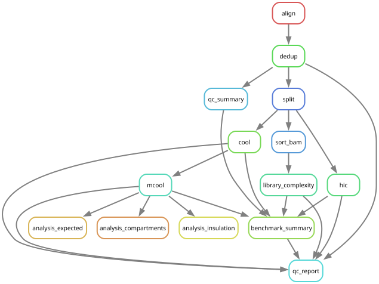

# Overview {.unnumbered}

**MicroCPipe** turns Micro-C sequencing data (FASTQ files) into contact
maps (`.cool`, `.mcool`, `.hic`) and a one-page QC dashboard that tells you
whether the library is good. It is modelled on the PhanstielLab
[dietJuicer](https://github.com/PhanstielLab/dietJuicer) pipeline: a
**Core** workflow (FASTQ to maps) and a **Merge** workflow (combine
libraries into one deeper map), driven by a samplesheet and a config file,
and run with Snakemake 8 on a SLURM cluster or on one machine.

::: {.callout-note}
**What has been tested.** The Core workflow (FASTQ to maps and QC) completed
all 12 steps on a 25-million-read-pair mouse embryonic stem cell library (whole
mm10 genome) on one SLURM cluster, and ran locally on a Mac. The Merge
workflow completed on two replicates, and the merged map's contacts were
exactly the sum of the replicates. The optional `analysis` options
(`expected`, `compartments`, `insulation`, `loops`) are off by default; each ran
and produced output on that library (not validated biologically).
Other sites' profiles are templates that may need small edits; issues and
pull requests are welcome.
:::

::: {.callout-note}
**Included example.** The shipped samplesheet and config describe a single
placeholder library (`GM12878`, human, hg38) with paths you must replace
(`/path/to/raw/`, `/path/to/hg38/...`). Swap in your own FASTQ files and
reference and the pipeline runs the same way.
:::

## How the pieces fit together

```text
  MicroCSamplesheet.txt                          config/MicroCConfig.yaml
  (one row per sequencing run: metadata,         (reference, mergeBy, outputs,
   Read1, Read2, Sequencing_Directory)            resolutions, QC thresholds)
          │                                                │
          └──────────────────────┬─────────────────────────┘
                                 ▼
                    workflows/MicroCPipe.snakefile        (Core)
                                 │
        align   (per sequencing run: bwa mem -> pairtools parse -> sort)
                                 │
        dedup   (per group: pairtools merge -> dedup, writes stats)
                                 │
        split ── sort_bam           (per group: .pairs.gz, sorted BAM)
           │          │
           │          └── library_complexity  (preseq)
           │
           ├── cool ── mcool        (cooler: .cool, then multi-resolution)
           ├── hic                  (juicer_tools pre)
           │
           │   dedup stats ── qc_summary          (per-group QC table)
           │
           └── [analysis_*]         (optional, off by default)

        benchmark_summary ── qc_report   (benchmarking.tsv, dashboard)
                                 │
                                 ▼
     output/{group}/…  +  output/qc/MicroC_qc_report.html

  MicroCMergeSamplesheet.txt  ──►  workflows/MicroCMerge.snakefile  (Merge)
  (pairs.gz from Core)             merge_pairs ── cool ── mcool / hic
```

A **group** is one library: the samplesheet rows that share the values of
the `mergeBy` columns. Every output file is named after its group.

The same workflow as a rule graph (every optional output switched on; each box is a rule,
each arrow a dependency):

{fig-alt="Rule graph of the Core workflow: align, dedup, split, cool, mcool, hic, sort_bam, library_complexity, qc_summary, optional analysis rules, benchmark_summary and qc_report."}

*Generated from the Snakefiles' rule graph; if you change a rule, update the diagram by hand.*

## What you get

| File | What it is | Use it for |
|------|-----------|------------|
| `{group}.cool` | One contact matrix at `base_resolution` | Python / R, cooler, cooltools |
| `{group}.mcool` | Matrices at every resolution, ICE-balanced by default | HiGlass, cooltools, `cooler` |
| `{group}.hic` | Juicebox format with juicer's own normalisations | Juicebox, straw |
| `{group}.pairs.gz` | The deduplicated read pairs the maps are built from | Re-binning, other tools |
| `output/qc/MicroC_qc_report.html` | Static QC dashboard for all libraries | Judging a run in minutes |

Which formats are built is set by `outputs` in the config (any subset of
`cool`, `mcool`, `hic`).

## The QC dashboard

The last step of the Core workflow writes `output/qc/MicroC_qc_report.html`,
a single file you can open in a browser or email to a collaborator. It
shows mapping rate, duplicates, cis / trans, short-range versus long-range
cis, pair types, the contact-probability curve P(s) with the nucleosome
shoulder, strand orientation, library complexity and the cost of each step,
with traffic lights from `qc_thresholds` in the config. See
[Reading the QC dashboard](qc.qmd).

## Compute sites

Everything specific to a cluster lives in one folder under `profiles/`:
`local` (one machine, no scheduler), `slurm-template` (copy it for any SLURM
cluster) and `biowulf`, `longleaf`, `pioneer` (examples for particular sites,
which still need your account and partition). The profile is
picked with `--profile`, `$MICROC_PROFILE` or `hpcProfile` in the config.
See [Cluster Reference](cluster.qmd).

## Where to go next

| If you want to... | Read |
|-------------------|------|
| Understand what Micro-C is and what the pipeline does to the reads | [From reads to maps](journey.qmd) |
| Follow one library from samplesheet to maps | [Vignette](vignette.qmd) |
| Install and configure | [Setup](setup.qmd) |
| Launch, merge, resume | [Running](running.qmd) |
| Judge whether a library is good | [Reading the QC dashboard](qc.qmd) |
| Do something specific (only `.mcool`, mouse, more memory) | [Recipes](recipes.qmd) |
| Fix an error, or read the logs | [Troubleshooting](troubleshooting.qmd) |
| Look up a config key | [Configuration](configuration.qmd) |
| Run on another cluster, or choose memory and time | [Cluster Reference](cluster.qmd) |

## References

- dietJuicer, <https://github.com/PhanstielLab/dietJuicer>. The pipeline layout MicroCPipe follows.
- Dovetail Genomics Micro-C, <https://github.com/dovetail-genomics/Micro-C>. Alignment recipe and QC table.
- Open2C pairtools, cooler and cooltools. See [References](references.qmd) for the full list.
